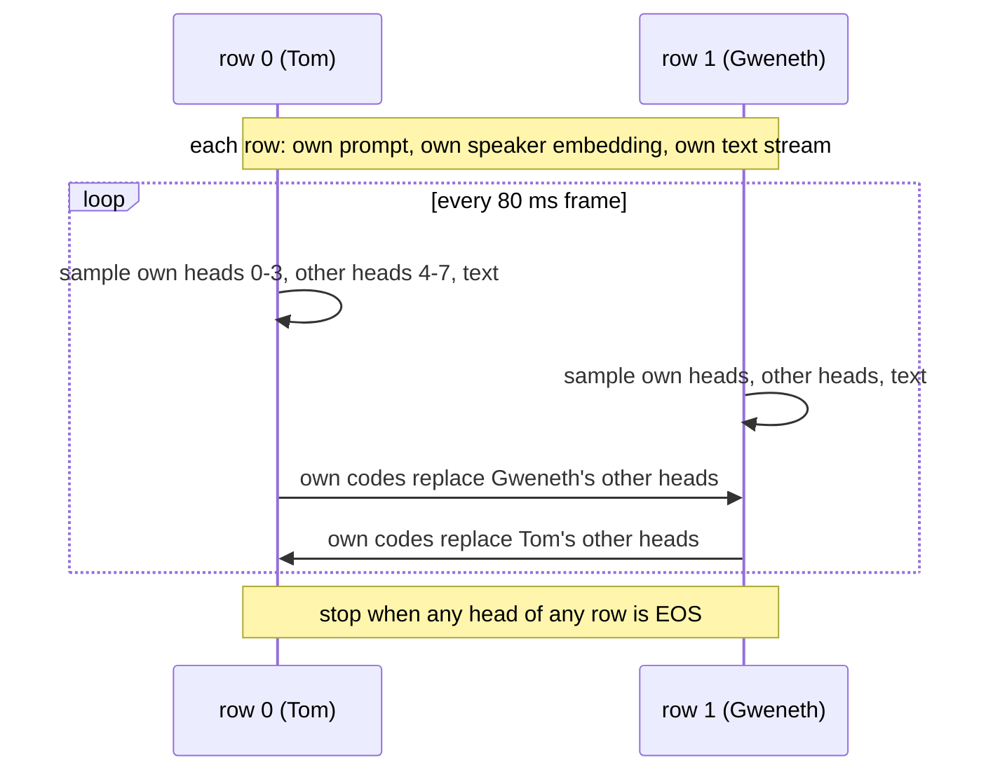

# Railroad sketches of the baseline (draft)

First sketches for Mermaid's `railroad-beta` diagram (Obsidian renders the blocks below if its bundled Mermaid has the diagram type).
Config assumed: the released checkpoint / `scripts/train/train_nanocodec_special_tokens.sh`
(`num_dsus 4`, `text_stream`, `n_delay_audio_stream 2`, `word_alignment`, `add_bc_token`, `add_interrupt_token`, `use_system_narrative`).
Facts and line references come from `model_walkthrough.md`; this file only redraws them.

Status: every `railroad-beta` block parses with `@mermaid-js/parser` 2.0.1 (the parser of Mermaid 12.3.0). The rendering was not looked
at: layout and the width of the long terminals (C, F) need a look in Obsidian. The `sequenceDiagram` in G was not checked.

## What a railroad diagram can and cannot show here

A railroad diagram draws a grammar: each path from left to right is one legal sequence. It fits whatever in the model is a
sequence with rules about what may follow what:

| candidate | fit | why |
|---|---|---|
| A. system text stream (word alignment) | good | a real token grammar, written by `create_text_stream` |
| B. same stream, utterance alignment | good | the difference to A is the point; two diagrams side by side |
| C. prompt template | good | fixed text with slots, `build_prompt` |
| D. one audio head over time | fair | very small grammar (delay, codes, EOS), but it states the id ranges |
| E. Llama input sequence of a training sample | fair | order of the blocks is a grammar; the content of one frame is not |
| F. `generate` loop | fair | reads as a flow chart drawn with railroad boxes; a loop with two exits |
| text leads audio by 2 frames | no | a relation between two parallel streams |
| frame = sum of 8 audio + 1 text embedding | no | parallel, not sequential |
| loss mask, label shift | no | per-position properties, not order |
| two instances exchanging audio | no | two actors; a `sequenceDiagram` fits (sketch G) |

Syntax used: `sequence`, `choice`, `optional`, `zeroOrMore`, `oneOrMore`, `terminal("...")`, `nonterminal("...")`. The grammar also has
`special("...")` (not used here) and `%%` comments. Rule names: letters, digits, `_`, `-`. There is also `railroad-ebnf-beta`, which takes plain EBNF (`a = b , { c } ;`)
and would make A to D shorter to write.

## A. System text stream, word alignment (baseline)

One token per 80 ms frame. `get_text_stream.py:36-211`.

```mermaid
railroad-beta
title Text stream of the system speaker (word alignment)

text_stream = sequence(
    zeroOrMore(choice(
        terminal("[SILENCE_PAD]"),
        nonterminal("segment")
    )),
    nonterminal("audio_delay_tail")
) ;
segment = sequence(
    optional(choice(terminal("[BC]"), terminal("[INTER]"))),
    nonterminal("word"),
    zeroOrMore(sequence(
        zeroOrMore(terminal("[UTTERANCE_PAD]")),
        nonterminal("word")
    ))
) ;
word = sequence(
    oneOrMore(terminal("subword token")),
    zeroOrMore(terminal("[WORD_PAD]"))
) ;
audio_delay_tail = sequence(
    terminal("[SILENCE_PAD]"),
    terminal("[SILENCE_PAD]")
) ;
```

Reading:
- `segment` = one utterance of the system speaker, or one of its backchannels inside the user's utterance. `[BC]` / `[INTER]` is
  tokenized together with the first word (`"[BC] yeah"`), so it takes the first frame of that word.
- `word`: its tokens start at the frame of the word's start time; the rest of the word's duration is `[WORD_PAD]`. A word with more
  tokens than frames pushes the next word later (`last_end_idx`).
- `[UTTERANCE_PAD]` only appears between words of one segment; `[SILENCE_PAD]` only outside segments.
- `audio_delay_tail`: the two frames appended by `add_audio_delay`, which is what makes the text lead the audio by 2 frames.

What the diagram hides: how many frames each loop runs is set by the word timings, not free.

## B. System text stream, utterance alignment (variant)

`train_nanocodec_utterance_alignment.sh`, the `else` branch at `get_text_stream.py:166-198`. All tokens of the utterance come first,
then padding to the end of the utterance. No `[WORD_PAD]`, and this script sets no `[BC]` / `[INTER]` flags.

```mermaid
railroad-beta
title Text stream of the system speaker (utterance alignment)

text_stream = sequence(
    zeroOrMore(choice(
        terminal("[SILENCE_PAD]"),
        nonterminal("segment")
    )),
    nonterminal("audio_delay_tail")
) ;
segment = sequence(
    oneOrMore(terminal("subword token")),
    zeroOrMore(terminal("[UTTERANCE_PAD]"))
) ;
audio_delay_tail = sequence(
    terminal("[SILENCE_PAD]"),
    terminal("[SILENCE_PAD]")
) ;
```

A next to B is the shortest explanation of the two alignment variants: in A a word token sits on the frame where the word is spoken,
in B only the first token of the utterance does.

## C. Prompt

`get_prompt.py:41-56`, with `use_system_narrative` and `speech=True`.

```mermaid
railroad-beta
title Prompt (build_prompt)

prompt = sequence(
    nonterminal("task"),
    nonterminal("narrative"),
    nonterminal("behaviors"),
    terminal("Ensure that the dialogue reflects the behaviours of you."),
    terminal("<|SOS|>")
) ;
task = sequence(
    terminal("Generate a dialogue between you ("),
    nonterminal("system_name"),
    terminal(") and another speaker ("),
    nonterminal("user_name"),
    terminal(") based on the given narrative. Follow the specific behavior instructions for you.")
) ;
narrative = sequence(
    terminal("Narrative:"),
    terminal("- "),
    nonterminal("narrative_of_system_speaker")
) ;
behaviors = sequence(
    terminal("Your behaviors:"),
    terminal("- backchannels: "),
    nonterminal("count"),
    terminal("- interruptions: "),
    nonterminal("count"),
    terminal("- starts the dialogue: "),
    choice(terminal("True"), terminal("False"))
) ;
```

Possible extension: `<|SOT|>` as the other branch of the last terminal (`speech=False`), and the inference prompt without the dash
(`prompt_format` other than `training`, see `CHANGES.md`) as an `optional(terminal("- "))`.

## D. One audio head over time

Each of the 8 heads (4 system codebooks, 4 user codebooks) has the same shape. Training sample, `modeling_dsu.py:30,54-55,282-283`.

```mermaid
railroad-beta
title One audio head (codebook) of a training sample

audio_head = sequence(
    terminal("DELAY 4032"),
    terminal("DELAY 4032"),
    oneOrMore(nonterminal("code")),
    terminal("EOS 4033")
) ;
code = terminal("NanoCodec code 0..4031") ;
```

Small, but it puts the vocabulary of a head (4034 ids) and the two special ids on one line. All 8 heads take the delay and the EOS on
the same frames; there is no delay between codebooks.

## E. Llama input sequence of a training sample

Positions of the sequence, `modeling_dsu.py:346-348`. A frame is written as one box although it is the sum of 9 embeddings; the label
says what the text slot and the 8 audio slots hold. `k` is the frame index of the grid.

```mermaid
railroad-beta
title Positions of one training sequence

training_sequence = sequence(
    terminal("proj(speaker embedding)"),
    oneOrMore(terminal("prompt token")),
    nonterminal("delay_frame"),
    nonterminal("delay_frame"),
    oneOrMore(nonterminal("audio_frame")),
    nonterminal("eos_frame")
) ;
delay_frame = terminal("text[k] + 8 x DELAY") ;
audio_frame = terminal("text[k] + system codes[k-2] x4 + user codes[k-2] x4") ;
eos_frame = terminal("text pad + 8 x EOS") ;
```

Lengths: `1 + P + (T+3)`. The text slot at frame `k` belongs to the audio at frame `k+2`.

## F. `generate` loop

`modeling_dsu.py:651-827`, both rows (the two instances) at once. This uses the railroad as a flow chart: boxes are actions, not tokens.

```mermaid
railroad-beta
title generate: one row of the two-instance loop

generate = sequence(
    nonterminal("context"),
    nonterminal("start"),
    zeroOrMore(nonterminal("step")),
    nonterminal("stop"),
    terminal("drop 2 delay frames, NanoCodec decode per channel")
) ;
context = sequence(
    zeroOrMore(terminal("left pad")),
    terminal("proj(speaker embedding)"),
    oneOrMore(terminal("prompt token"))
) ;
start = choice(
    oneOrMore(terminal("copy prefix frame")),
    sequence(nonterminal("delay_step"), nonterminal("delay_step"))
) ;
delay_step = sequence(
    terminal("write DELAY on 8 heads"),
    terminal("sample text token")
) ;
step = sequence(
    terminal("Llama on the last frame (KV cache)"),
    terminal("sample 8 heads + text token"),
    optional(terminal("silence_speaker1: row 0 own heads := silence code")),
    terminal("interleave_halves: other heads := partner's own heads")
) ;
stop = choice(
    terminal("any head == EOS 4033"),
    terminal("step == max_length - 1")
) ;
```

`start`: with a prefix its N frames (the 2 delay frames included) are copied in; without one, steps 0 and 1 write the delay id.

## G. Not a railroad: the two instances

What F cannot show is the exchange between the rows. A sequence diagram does:



## More ideas, not drawn

- Counting tokens: `[BC1]`..`[BC40]`, `[INTERRUPT1]`..`[INTERRUPT20]` in place of `[BC]` / `[INTER]` in A (`add_counting_tokens`); one changed rule.
- Inference text stream as the model actually writes it: the same grammar as A is the *expected* output; a diagram of what generated
  streams violate (a word token after `[SILENCE_PAD]` without a segment start, missing `[WORD_PAD]`) could go with the OOV analysis.
- The rows fine-tune sample as a concrete path through A: `[SILENCE_PAD]` x n, `okay`, `,`, `<word tokens>`, `[WORD_PAD]` x m. Shows where
  the 1 % of text targets that are word tokens sit.
- Data pipeline (row -> `prepare_dsu` -> `adapt_to_text_stream` -> `build_prompt`): a plain `flowchart LR` fits better than a railroad.
- Text leads audio by 2 frames: a table or a `packet-beta` block with two rows; no railroad.
